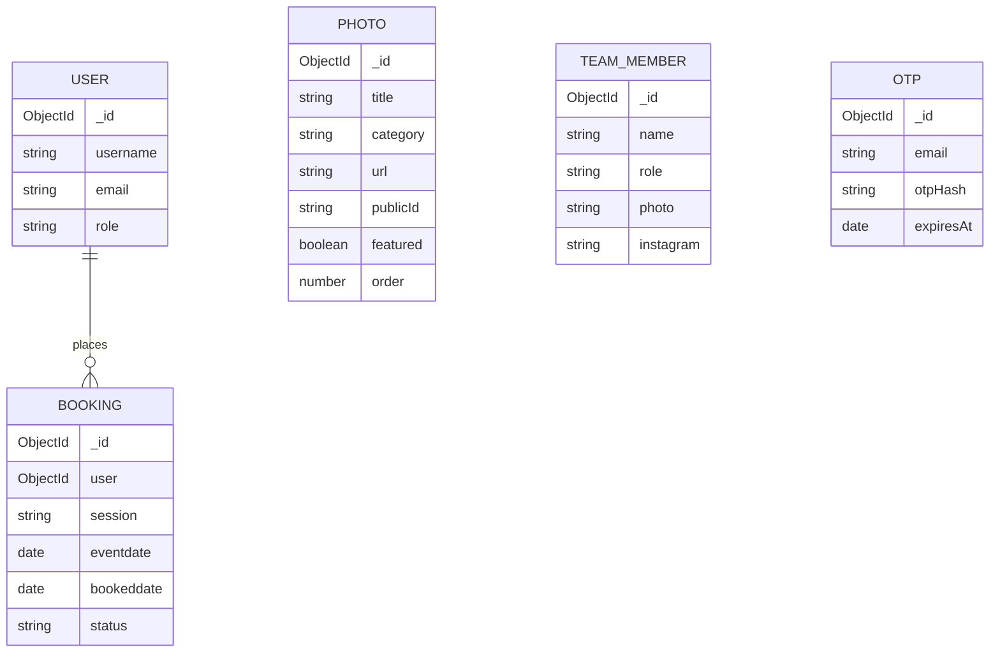
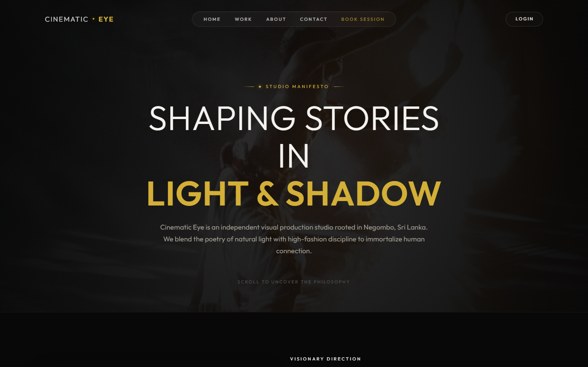

# Cinematic Eye

Cinematic Eye is a film and photography studio website where clients can explore the studio's work, meet the team, and request a booking. Administrators use a protected dashboard to review bookings and manage gallery photos and team-member profiles.

## Features

| Area | Create | Read | Update | Delete |
|---|---|---|---|---|
| Bookings | Authenticated clients submit a booking request. | Clients see their own bookings; the admin dashboard displays booking records. | Booking status can be changed to `pending`, `confirmed`, `completed`, or `cancelled`. | Booking records can be removed from the admin bookings screen. |
| Gallery | Administrators upload up to 20 photos at once; images are stored with Cloudinary. | Gallery photos are available publicly and appear in the client-facing gallery. | Administrators can edit photo details, including category, title, featured state, and order. | Administrators can delete photos. |
| Team members | Administrators add a member with a photo and profile details. | Team profiles are displayed publicly. | Administrators can edit a member's name, role, photo, and Instagram link. | Administrators can remove a member. |
| Administration | Administrators sign in through the regular account flow; accounts with the `admin` role can access the dashboard. | The dashboard summarizes bookings and provides booking, gallery, team, and settings views. | Administrators manage booking status, gallery entries, and team profiles. | Administrators delete bookings, gallery photos, and team profiles. |

Clients can register with email and password or Google sign-in, browse the portfolio and team, and submit booking requests. Authentication uses access tokens and an HTTP-only refresh-token cookie. Email OTP verification is also available in the booking flow.

## Technology stack

| Layer | Technologies |
|---|---|
| Frontend | React, Vite, React Router, CSS |
| Backend | Node.js, Express |
| Data | MongoDB Atlas, Mongoose |
| Media | Cloudinary |
| Authentication and email | JSON Web Tokens, Google OAuth, Nodemailer |

## Repository structure

```text
cinematic-eye/
├── backend/
│   ├── config/          # Environment and Cloudinary configuration
│   ├── controller/      # Request handlers
│   ├── database/        # MongoDB connection
│   ├── middleware/     # Authentication, upload, validation, and error handling
│   ├── models/          # Mongoose models
│   ├── routes/          # Express routers
│   ├── app.js
│   └── package.json
├── frontend/
│   ├── public/          # Public static assets
│   ├── src/
│   │   ├── admin/       # Admin layout, route guard, and dashboard pages
│   │   ├── assets/      # Photography and other imported assets
│   │   ├── components/  # Shared navigation, hero, gallery, and team components
│   │   ├── utils/       # Route guards and utilities
│   │   └── webpages/    # Home, about, login, register, booking, and profile pages
│   ├── package.json
│   └── vite.config.js
├── docs/
│   └── images/          # README screenshots and diagrams
└── README.md
```

## Setup

### Prerequisites

- Node.js 20.19+ (or a compatible newer LTS release) and npm
- A MongoDB Atlas database and connection string
- A Cloudinary account for gallery and team-photo uploads
- Gmail credentials (or an app password) for OTP email

### 1. Install dependencies

From the repository root, install each package separately:

```bash
cd backend
npm install
cd ../frontend
npm install
```

### 2. Configure the backend

The backend loads `.env.development.local` by default (or `.env.production.local` when `NODE_ENV=production`). Create `backend/.env.development.local`:

```env
PORT=5500
NODE_ENV=development
DB_URI=mongodb+srv://<username>:<password>@<cluster>/<database>
JWT_SECRET=<long-random-access-token-secret>
JWT_REF_SECRET=<different-long-random-refresh-token-secret>
JWT_EXPIRES_IN=15m
JWT_REFRESH_EXPIRES_IN=7d
CLOUDINARY_CLOUD_NAME=<cloud-name>
CLOUDINARY_API_KEY=<api-key>
CLOUDINARY_API_SECRET=<api-secret>
EMAIL_USER=<gmail-address>
EMAIL_PASS=<gmail-app-password>
```

Keep the environment file private; do not commit real credentials. `CLIENT_ID` and `META_TOKEN` are read by the backend environment module but are not currently required by the routes described here.

Start the API from the `backend/` directory:

```bash
npm start
```

The server listens on `http://localhost:5500` when `PORT=5500`.

### 3. Start the frontend

In another terminal:

```bash
cd frontend
npm run dev
```

Open the Vite URL shown in the terminal (by default, `http://localhost:5173`).

The current frontend does not read API settings from a `.env` file: API requests use `http://localhost:5500`, and the Google OAuth client ID is currently set in `frontend/src/App.jsx`. The backend CORS configuration also allows `http://localhost:5173`. Update these settings when using different hosts or deploying.

### Available scripts

| Directory | Command | Purpose |
|---|---|---|
| `frontend/` | `npm run dev` | Start the Vite development server |
| `frontend/` | `npm run build` | Create a production build |
| `frontend/` | `npm run preview` | Preview the production build |
| `frontend/` | `npm run lint` | Run ESLint |
| `backend/` | `npm start` | Start the Express API |

## API routes

The backend mounts these routers under `/api/v1`:

| Base path | Method and endpoint | Purpose | Access |
|---|---|---|---|
| `/auth` | `POST /sign-up` | Create an email/password account | Public |
| `/auth` | `POST /sign-in` | Sign in and issue tokens | Public |
| `/auth` | `POST /sign-out` | Clear the refresh-token cookie | Public |
| `/auth` | `POST /refresh` | Issue a new access token from the refresh cookie | Refresh cookie |
| `/auth` | `POST /google-signup` | Sign in or register with a Google credential | Public |
| `/users` | `GET /` | List users | Public |
| `/users` | `GET /:id` | Get a user by ID | Authenticated |
| `/users` | `DELETE /:id` | Placeholder handler only; user deletion is not implemented | No authorization middleware |
| `/booking` | `POST /` | Create a booking for the authenticated user | Authenticated |
| `/booking` | `GET /records` | Get the authenticated user's bookings | Authenticated |
| `/booking` | `GET /all` | Get all bookings (used by the admin dashboard) | Authenticated |
| `/booking` | `PATCH /:id/status` | Change a booking status | Authenticated; users are limited to their own bookings |
| `/booking` | `DELETE /:id/delete` | Delete a booking | Authenticated |
| `/otp` | `POST /send` | Send a booking-verification OTP (rate limited) | Public |
| `/otp` | `POST /verify` | Verify an OTP | Public |
| `/gallery` | `GET /` | List gallery photos | Public |
| `/gallery` | `POST /` | Upload gallery photos | Admin |
| `/gallery` | `PATCH /:id` | Update a gallery photo | Admin |
| `/gallery` | `DELETE /:id` | Delete a gallery photo | Admin |
| `/members` | `GET /` | List team members | Public |
| `/members` | `POST /` | Add a team member | Admin |
| `/members` | `PATCH /:id` | Update a team member | Admin |
| `/members` | `DELETE /:id` | Delete a team member | Admin |
| `/member` | Same methods as `/members` | Alias for the team-member router | Same as `/members` |

For example, the full endpoint to list gallery photos is `GET http://localhost:5500/api/v1/gallery`.

## Data model

The booking records reference a user. Gallery photos and team members are separate collections; image URLs and Cloudinary public IDs are stored with gallery photo data. OTP records are temporary and expire automatically.



## Screenshots

The repository includes an About-page screenshot captured from the running frontend:



Additional screenshots for the homepage, gallery, booking, and admin dashboard can be saved in `docs/images/` and embedded here. The admin pages require an authenticated admin account to capture.

## Original repositories

This project was merged from:

- [cinematic-eye-backend](https://github.com/Rv2003/cinematic-eye-backend)
- [cinematic-eye-webpage](https://github.com/Rv2003/cinematic-eye-webpage)

## Author

**Rusiru Vinvidu**  
GitHub: [@Rv2003](https://github.com/Rv2003)
